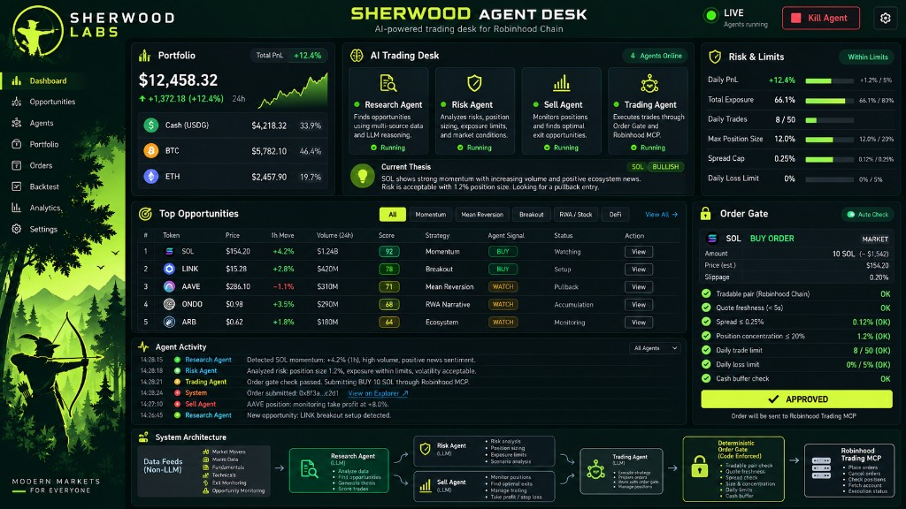

# Robinhood AI Crypto Agent



A long-running agent that trades **crypto only** in a Robinhood Agentic account. Each cycle, Claude
reads the account, a research brief, and live public market data, decides whether anything is worth
owning, sizes the order, and submits it. Every order passes through a code-enforced risk gate first.
The model cannot widen that gate from inside the trading session.

Python 3.10 or newer. The Claude Agent SDK talks to Robinhood's MCP server. This repository does not
store a Robinhood password or token. It reuses the login you approve once in Claude Code.

## Read this first

- `DRY_RUN=true` (the example default) asks Robinhood to **preview** an order. Nothing is placed.
- `python run_once.py --live`, and `DRY_RUN=false` on the daemon, place **real crypto orders with real money**.
  This is not financial advice. An LLM's trade has no expectation of profit.
- Trading is confined to the Agentic account. Fund it only with money you can afford to lose.
- The trading session is capped around **$0.50** of Claude usage (`MAX_CYCLE_BUDGET_USD`). The sessions
  around it are larger: research up to **$10**, risk up to **$5**, the sell review up to **$5**, and the
  weekly review up to **$4**. A full live cycle can cost much more than the trading cap alone.
- With `ANTHROPIC_API_KEY` empty, the SDK uses your Claude Code login instead of per-token API billing.
  A blank key is removed on startup so it cannot shadow that login.

Robinhood's MCP server exposes no crypto historicals, no crypto news, and equity-only technical
indicators. From the broker, a crypto decision rests on a live quote, the previous close, and the
spread. Price history, headlines, funding, and the macro tape are fetched by this project's own code
from public sources and pasted into the prompt. The trading agent is told to call a coin flip a coin
flip rather than dress a thin book up as a thesis.

## What one cycle does

`run_once.py` is the scheduled entry. `main.py` is the same cycle in a loop. Order of work:

1. **Research desk** (`src/rh_agent/agents/research_agent.py`), if `RESEARCH_ENABLED=true`.
   Read-only: market-data tools, Robinhood `search` / quotes / catalog, plus `WebSearch` and `WebFetch`.
   No account reads and no order tools. It returns up to six candidates with thesis, catalyst,
   invalidation, and conviction, a hold / trim / exit call on each holding, and pairs to avoid.
   Picks are appended to `logs/research_picks.jsonl` and later scored against buying BTC. If the desk
   errors or passes `RESEARCH_TIMEOUT_MINUTES` (45), the trader continues with no brief and scans
   the catalog itself.
2. **Risk agent** (`src/rh_agent/agents/risk_agent.py`), if `RISK_AGENT_ENABLED=true`.
   Account reads only. It sets this run's order size, per-pair cap, per-theme cap, trade count,
   volatility target, cooldown, and max spread, against `GROWTH_TARGET_USD` (default $5,000).
   `risk_policy.py` rejects a policy outside the valid ranges below and writes the accepted one to
   `logs/risk_policy.jsonl`. A missing or invalid policy falls back to the fixed `.env` limits.
   The daily loss breaker is not one of its knobs.
3. **Sell agent** (`src/rh_agent/agents/sell_agent.py`), if `SELL_AGENT_ENABLED=true`.
   Rules on every holding — sell, trim, or hold — before any new buy, and records an exit plan
   (take-profit, stop, invalidation price). The gate for this session is sell-only: a buy is rejected
   in code. Sells are exempt from the daily order count so a spent buy budget cannot trap a position.
4. **Trading agent** (`src/rh_agent/agents/agent.py`). The only session that can open a position.
   - Reads the brief, the journal (`JOURNAL_LOOKBACK` cycles), lessons, headlines, and price context.
   - Calls `get_accounts`, `get_portfolio`, `get_crypto_positions`, then quotes what it might trade.
   - The tradable universe comes from a cached catalog (`logs/pairs_catalog.json`). It pages
     `get_currency_pairs` only when a symbol is missing.
   - A `PostToolUse` hook parses Robinhood's own responses into cycle state. The gate does not trust
     numbers the model types into the order.
   - A `PreToolUse` hook runs `order_gate.py` on the exact tool input. The hook denies the call,
     allows it, or rewrites `dollar_amount` down to what the limits allow.

`--require-trade` tells that trading session to place exactly one buy. It is a flag on that process,
not a setting, so the daemon cannot be left forcing trades. If the session ends without a buy and
budget remains, it is prompted once more to place the order with data it already fetched.

When the day's buy budget is already spent and there is no one-shot instruction waiting,
`run_once.py` skips research and the trading session and still runs the sell review on a `--live` run.

### One-shot instruction

`logs/next_run_instruction.txt` is read by a live `run_once.py`, included in the prompt, and deleted
only after a session actually finishes. A usage-limit stop or a crash leaves the file in place.
The opportunity watch writes this file when it wakes a cycle. If you create it yourself, the next
live run consumes it. A live run with an instruction still starts when the buy budget is spent, so
the risk agent can re-set that budget.

### Lock

A live cycle writes `logs/cycle.lock` with its pid. A second live cycle exits while the lock is
younger than 120 minutes. An older lock is treated as abandoned.

## Between cycles

These are plain Python. They spend no Claude usage until they decide to wake an agent.

| Launcher | What it does |
| --- | --- |
| `mover_monitor.py` | Every run, one Coinbase request for every spot product. Appends a snapshot and computes 15m / 1h / 4h moves from its own history (kept 6 hours). 24h change and volume come from Coinbase. Alerts when 1h move ≥ `MOVER_1H_PCT` (4%), 24h move ≥ `MOVER_24H_PCT` (10%), or volume surge ≥ `MOVER_VOLUME_SURGE_PCT` (1.5×). Writes `logs/movers_latest.json` and `logs/mover_alerts.jsonl`. |
| `exit_watch.py` | Compares live mover prices with each holding's entry and exit plan. Wakes the sell agent on a stop, a take-profit, an invalidation price, or a 6% drop in an hour. Ignores positions under $5. At most 4 wakes a day, and the same position at most once every 4 hours. `--dry-run` reports only. `--live` forces real sells. Without `--live`, a `DRY_RUN=true` environment only simulates the exit. |
| `opportunity_watch.py` | Looks for an entry setup in the mover feed: 1h move ≤ −5%, 24h volume ≥ 3× the prior day with the 24h price up at least 8%, or 24h move ≤ −12%. On a hit it writes `logs/next_run_instruction.txt` and runs `run_once.py --live`. It does not wake when the buy budget is spent, buying power is under $15 or the account snapshot is missing or older than 24 hours, a cycle lock is held, two unscheduled wakes already happened today, an instruction file is already waiting, or the same pair was woken in the last 6 hours. `--dry-run` reports only. |

## What the gate enforces

`src/rh_agent/execution/order_gate.py` sees only figures parsed from Robinhood tool results earlier
in the same process. Unknown means no order.

- **Account.** The order's account number must be the one `get_accounts` marked `agentic_allowed`.
- **Catalog.** A crypto pair must be in the parsed `get_currency_pairs` data (including the on-disk
  catalog from earlier cycles), tradable on this account, and not halted in all regions. A regional
  halt does not by itself block the order.
- **Shape.** Crypto orders are market, `time_in_force=gtc`, sized with `dollar_amount` only.
  `quantity`, `limit_price`, `stop_price`, and `tax_lots` are rejected.
- **Spread.** Bid/ask spread must be inside the session's max spread. A one-sided book is refused.
- **Freshness.** Portfolio or positions older than `MAX_STATE_AGE_SECONDS` (900s), or a quote older
  than `MAX_QUOTE_AGE_SECONDS` (300s), are refused. Pull them again immediately before ordering.
- **Size.** The order is cut down to the tightest of: per-order percent of account value, per-pair
  cap, theme-cluster cap, buying power minus cash already committed this cycle, `MIN_CASH_BUFFER`,
  and the pair's minimum unit size. Anything under $1 after those cuts is denied.
- **Volatility.** On a buy, if the pair's 30-day daily standard deviation (from Coinbase candles)
  is above `VOL_TARGET_PCT` (3%), size is scaled down in proportion. The scaler only shrinks.
- **Cooldown.** A buy of a pair bought inside `SYMBOL_COOLDOWN_HOURS` (24h) is churn and is denied.
  Sells ignore the cooldown. `MIN_HOLD_HOURS` (default 0, off) can additionally block a sell.
- **Daily budget.** Approved orders are counted in `logs/daily_state.json` (live) or
  `logs/daily_state_dry_run.json`. A restart does not reset the count. The loss breaker, measured
  from the day's opening account value, blocks further buys. `MAX_DAILY_LOSS_USD` above zero
  replaces `MAX_DAILY_LOSS_PCT`. Sells from the exit session do not consume the count.
- **Sell-only sessions.** The exit agent cannot buy.

A hook denial applies in every Claude permission mode. Any tool whose exact name is not on the
allowlist in `src/rh_agent/broker/rh_tools.py` is denied, including tools Robinhood ships later.
Names are exact. The list is not a prefix.

The risk agent may set limits only inside these ranges. Outside them the whole policy is discarded,
not clamped:

| Field | Valid range |
| --- | --- |
| `per_order_pct` | 1% – 100% of account value |
| `max_position_pct` | 5% – 100% |
| `max_theme_pct` | 10% – 100% of the account in one correlated cluster |
| `max_trades_today` | 0 – 20 |
| `vol_target_pct` | 0 – 100% (0 turns scaling off) |
| `cooldown_hours` | 0 – 168 |
| `max_spread_pct` | 0.5% – 10% |

Theme membership starts from the labels in `src/rh_agent/market/themes.py` (for example several DeFi
names sharing one bet). The correlation setting `THEME_CORRELATION` (0.6) groups pairs that move
together after BTC is removed. The per-pair cap alone did not stop AAVE + UNI + ONDO + LINK from
becoming most of the account.

## What the trading agent cannot call

Equities and options are not exposed, so SPY or AAPL already in the account are context only. Also
blocked: cancel, option exercise, alerts, watchlist edits, scanners, and the built-in file, shell,
and web tools (`Bash`, `Read`, `Write`, `Edit`, `WebSearch`, `WebFetch`, and the rest of that list).

The research desk is the exception for the web: it may search and fetch pages, and it still cannot
read the account or place an order. The weekly review has no tools at all.

In dry run the model is given `preview_crypto_order` and `place_crypto_order` is removed from its
tool list. In live mode both exist; the gate is what decides whether a place call goes out.
`preview_crypto_order` stays available in live mode as a read.

## Other sessions

**Weekly review** (`review_agent.py`). Reads the journal, scorecard, lessons, and recent policies,
and writes up to four lessons per agent (research, risk, sell, trader) into `logs/lessons.json`.
Lessons expire after 21 days. The next cycles include the lessons addressed to them. This session
does not trade and does not change limits. Its `DRY_RUN` default when launched directly is live
record-reading only; it has no order tools.

**Manager** (`manager_agent.py`). Written to edit the desk from the performance record, including
`order_gate.py`, `rh_tools.py`, risk policy, and `.env`. It commits a git snapshot first, imports
every package module in a fresh interpreter, and `git reset --hard` back to that snapshot if the
tree no longer imports. `--dry` is supposed to propose without writing. As the tree stands, this
launcher raises `AttributeError`: `config.py` does not define `manager_agent_enabled`,
`manager_allow_bash`, `manager_max_turns`, `manager_budget_usd`, or `manager_effort`. Do not schedule
it until those settings exist.

**Scorecard** (`scorecard.py`). Scores past decisions at 1, 7, and 30 days, net of the quoted
spread, against holding BTC over the same window. Prints the report. Also records the `PASSED:`
line from each trading summary so skipped candidates are visible later.

**Status page** (`status_page.py`). Reads the logs and writes `status.html` at the repository root
(gitignored; it contains positions and P&L). The page states when it was built. It is a snapshot,
not a live account view. Prices on it are daily closes.

## Data the code fetches

No API keys. Each feed caches under `logs/` and, on failure, keeps a stale copy rather than going
blank. The trading agent itself has no web tools, so a page on the internet cannot call an order
tool. The research desk can browse; treat that as a prompt-injection surface, not as account access.

| Module | Source | Used for |
| --- | --- | --- |
| `market/mover_monitor.py` | Coinbase brokerage products | Live price, 24h change, volume; short-window moves from local snapshots |
| `market/market_context.py` | Coinbase daily candles | 1d / 7d / 30d moves, 30-day range, realized volatility. Cached one day. |
| `market/technicals.py` | Coinbase hourly candles and level-2 book, OKX open interest | Relative volume, VWAP, depth, RSI, OBV, open interest |
| `market/fundamentals.py` | DefiLlama, CoinGecko, alternative.me, OKX funding | Protocol TVL, stablecoin supply, sector moves, Fear & Greed, perp funding |
| `market/coin_universe.py` | CoinGecko | Market cap, supply, and which ticker maps to which asset. A broker mark that disagrees with the public price is not trusted. |
| `market/macro_feed.py` | Yahoo Finance chart | 10-year yield, dollar index, WTI, gold, VIX, S&P, Nasdaq, IBIT, ETHA. Cached 15 minutes. |
| `market/crypto_news.py` | CoinDesk, Cointelegraph, Decrypt RSS | Headlines inside `CRYPTO_NEWS_LOOKBACK_HOURS`, capped at `CRYPTO_NEWS_MAX_ITEMS` |
| `market/congress.py` | `CONGRESS_API_URL` (bargo.ai by default) | STOCK Act filings. They are stock and ETF trades, disclosed up to ~45 days late. `.env.example` leaves `CONGRESS_ENABLED=true`. Set it to `false` when you want the crypto desk to ignore them. |

## Setup

From the repository root, in PowerShell:

```powershell
python -m venv .venv
.\.venv\Scripts\Activate.ps1
pip install -e .
copy .env.example .env
```

`pip install -e .` installs `claude-agent-sdk`, `python-dotenv`, and `tzdata`, and exposes two
console scripts: `rh-agent` (the daemon) and `rh-agent-once` (one cycle). `requirements.txt` lists
the same dependencies. The `.py` files at the repository root are launchers; they put `src/` on the
path and run the matching module, which is what scheduled tasks already call.

Connect Robinhood once, in Claude Code:

```powershell
claude mcp add robinhood-trading --transport http https://agent.robinhood.com/mcp/trading
```

Then run `/mcp` inside Claude Code, select `robinhood-trading`, and approve it for the Agentic
account. `.mcp.json` in this repo points at `https://agent.robinhood.com/mcp/trading`. If that file
is missing, `main.py` exits before the loop.

Leave `ANTHROPIC_API_KEY` blank unless you intend to bill an API key. `CLAUDE_MODEL` defaults to
`claude-opus-5`. Effort (`AGENT_EFFORT`, `RESEARCH_EFFORT`, and the other `*_EFFORT` values) is one
of `low`, `medium`, `high`, `xhigh`, `max`.

Stay on `DRY_RUN=true` until several days of `logs/trades.csv` and `logs/journal.jsonl` look like
decisions you would accept. `--live` on `run_once.py` forces `DRY_RUN=false` for that process and
wins over `.env`. Running `run_once.py` without `--live` forces dry run, also winning over `.env`.
The daemon `main.py` follows `.env`.

## Run

Daemon, honoring `.env`:

```powershell
.\.venv\Scripts\python.exe main.py
```

It sleeps `POLL_INTERVAL_SECONDS` (3600) between cycles. With `MARKET_HOURS_ONLY=true` it skips a
cycle outside the US cash session, weekdays 09:30–16:00 America/New_York. Holidays are not modeled.
Crypto itself trades all week; the flag only skips the model. Ctrl+C finishes the current sleep
tick and stops the loop.

One cycle. This is the scheduled command:

```powershell
.\.venv\Scripts\python.exe run_once.py --live
.\.venv\Scripts\python.exe run_once.py --live --require-trade
.\.venv\Scripts\python.exe run_once.py
```

The last of those is a dry run even if `.env` says otherwise.

Other launchers:

```powershell
.\.venv\Scripts\python.exe mover_monitor.py
.\.venv\Scripts\python.exe exit_watch.py --dry-run
.\.venv\Scripts\python.exe exit_watch.py --live
.\.venv\Scripts\python.exe opportunity_watch.py --dry-run
.\.venv\Scripts\python.exe opportunity_watch.py --live
.\.venv\Scripts\python.exe review_agent.py
.\.venv\Scripts\python.exe scorecard.py
.\.venv\Scripts\python.exe research_agent.py --report
.\.venv\Scripts\python.exe status_page.py
```

Console and `logs/agent.log` both receive the log line. Order attempts, including denials and
size cuts, go to `logs/trades.csv`. The cycle summary and token counts go to `logs/journal.jsonl`.

Do not start two live cycles at once. They share the daily order counter and the lock exists so
the second one leaves.

## Settings

Values below are the defaults in `config.py` when the variable is unset. `.env.example` matches
them unless noted. Fractions are fractions of 1: `0.50` is 50%, `0.025` is 2.5%.

### Model and schedule

| Setting | Default | Meaning |
| --- | --- | --- |
| `ANTHROPIC_API_KEY` | empty | Set to bill an API key. Empty uses the Claude Code login. |
| `CLAUDE_MODEL` | `claude-opus-5` | Model for every session. |
| `AGENT_EFFORT` | `max` | Trading-session effort. |
| `DRY_RUN` | `true` | `true` previews. `false` on the daemon places orders. See Run for how `--live` overrides this. |
| `POLL_INTERVAL_SECONDS` | `3600` | Pause between daemon cycles. |
| `MARKET_HOURS_ONLY` | `true` | Daemon skips cycles outside the US cash session. |
| `MAX_CYCLE_BUDGET_USD` | `0.50` | Claude spend cap for the trading session. |
| `MAX_CYCLE_TURNS` | `60` | Turn cap for the trading session. |
| `JOURNAL_LOOKBACK` | `5` | Past cycles included in the trading prompt. |
| `LOG_DIR` | `logs` | Relative paths are resolved from the repository root. |

### Research, risk, sell, review

| Setting | Default | Meaning |
| --- | --- | --- |
| `RESEARCH_ENABLED` | `true` | Run the research desk before trading. |
| `RESEARCH_EFFORT` | `max` | |
| `RESEARCH_MAX_TURNS` | `150` | |
| `RESEARCH_BUDGET_USD` | `10` | |
| `RESEARCH_TIMEOUT_MINUTES` | `45` | After this the trader proceeds without a brief. |
| `RISK_AGENT_ENABLED` | `true` | `false` keeps the fixed limits below for every run. |
| `RISK_EFFORT` | `high` | |
| `RISK_MAX_TURNS` | `40` | |
| `RISK_BUDGET_USD` | `5` | |
| `GROWTH_TARGET_USD` | `5000` | Read in `risk_policy.py`. The target the risk agent explains its limits against. Not in `.env.example`. |
| `SELL_AGENT_ENABLED` | `true` | |
| `SELL_EFFORT` | `high` | |
| `SELL_MAX_TURNS` | `40` | |
| `SELL_BUDGET_USD` | `5` | |
| `REVIEW_EFFORT` | `high` | Weekly review. |
| `REVIEW_MAX_TURNS` | `20` | |
| `REVIEW_BUDGET_USD` | `4` | |

### Fixed limits

These are the fallback when the risk agent is off or its policy is rejected, and they are the
ceiling the trading prompt is told about before a policy replaces them for that run. The loss
breaker always comes from here.

| Setting | Default | Meaning |
| --- | --- | --- |
| `MAX_TRADE_PCT` | `0.50` | Largest single order as a share of account value. |
| `MAX_POSITION_PCT` | `0.30` | Largest holding in one pair. |
| `MAX_THEME_PCT` | `0.65` | Largest share in one correlated cluster. |
| `THEME_CORRELATION` | `0.6` | Correlation, after stripping BTC, that puts two pairs in one cluster. |
| `MAX_DAILY_LOSS_PCT` | `0.15` | Drawdown from the day's open that blocks new buys. |
| `MAX_DAILY_LOSS_USD` | `0` | Above zero, this dollar drawdown replaces the percentage. |
| `MAX_TRADES_PER_DAY` | `3` | Approved orders per calendar day. Protective sells are not counted. |
| `MIN_CASH_BUFFER` | `0` | Cash that must remain after a buy. |
| `MAX_SPREAD_PCT` | `0.025` | Widest bid/ask the gate will trade into. |
| `SYMBOL_COOLDOWN_HOURS` | `24` | Minimum hours between buys of the same pair. |
| `MIN_HOLD_HOURS` | `0` | Minimum hours before a sell. `0` is off. |
| `VOL_TARGET_PCT` | `0.03` | Daily volatility above which buy size shrinks. `0` disables scaling. |
| `STOP_LOSS_PCT` | `0.15` | Advisory, and the fallback stop the exit watch uses when the sell agent has not written a plan. |
| `TAKE_PROFIT_PCT` | `0.25` | Same, for the upside. |
| `MAX_QUOTE_AGE_SECONDS` | `300` | |
| `MAX_STATE_AGE_SECONDS` | `900` | |
| `CONTEXT_SYMBOLS_MAX` | `24` | How many pairs get candle context in the prompt. |

### News, filings, movers

| Setting | Default | Meaning |
| --- | --- | --- |
| `CRYPTO_NEWS_ENABLED` | `true` | |
| `CRYPTO_NEWS_FEEDS` | CoinDesk, Cointelegraph, Decrypt | Comma-separated RSS URLs. |
| `CRYPTO_NEWS_LOOKBACK_HOURS` | `24` | |
| `CRYPTO_NEWS_MAX_ITEMS` | `20` | |
| `CRYPTO_NEWS_TIMEOUT_SECONDS` | `10` | |
| `CONGRESS_ENABLED` | `true` | |
| `CONGRESS_API_URL` | bargo.ai congress trades | |
| `CONGRESS_LOOKBACK_DAYS` | `60` | |
| `CONGRESS_MAX_ROWS` | `40` | Rows kept before the digest is trimmed further for the prompt. |
| `CONGRESS_TIMEOUT_SECONDS` | `20` | |
| `MOVER_1H_PCT` | `0.04` | Alert threshold. |
| `MOVER_24H_PCT` | `0.10` | |
| `MOVER_VOLUME_SURGE_PCT` | `1.50` | |

Dry-run and live modes use separate decision and daily-state files, so a dry run does not consume
the live order budget.

## Records

Everything under `logs/` is gitignored. Paths assume `LOG_DIR=logs`.

| Path | Contents |
| --- | --- |
| `logs/agent.log` | Process log. |
| `logs/trades.csv` | Every order attempt: side, dollars requested, dollars allowed, spread, decision, reason. |
| `logs/journal.jsonl` | Cycle summary, orders, dollar cost, token counts. |
| `logs/decisions.jsonl` | Live buys and sells, for the scorecard. Dry runs use `decisions_dry_run.jsonl`. |
| `logs/passes.jsonl` | Candidates the trader named on the `PASSED:` line. |
| `logs/daily_state.json` | Opening value and orders used today. Dry runs use `daily_state_dry_run.json`. |
| `logs/risk_policy.jsonl` | Each accepted policy and the account value it was set against. |
| `logs/research_picks.jsonl`, `logs/research/` | Ranked picks and the full brief. `research_latest.json` is the newest brief. |
| `logs/lessons.json` | Lessons the weekly review wrote. |
| `logs/reviews.jsonl` | The review's own summary. |
| `logs/exit_plans.json` | Per-position stop, target, and invalidation price. |
| `logs/positions_cache.json` | Last holdings the broker reported. |
| `logs/portfolio_snapshot.json` | Last account value and crypto buying power. The opportunity watch uses this. |
| `logs/pairs_catalog.json` | Currency pairs already paged from Robinhood. |
| `logs/rh_marks.json` | Broker marks, so a ticker is not mapped onto the wrong public asset. |
| `logs/themes.json` | Theme labels beyond the seed list. |
| `logs/movers_latest.json`, `mover_snapshots.jsonl`, `mover_alerts.jsonl` | Mover monitor. |
| `logs/exit_watch.json`, `opportunity_watch.json` | Wake counts and per-symbol cooldowns. |
| `logs/cycle.lock` | Live cycle lock. |
| `logs/next_run_instruction.txt` | One-shot instruction for the next live run. |
| `logs/*_cache.json` | Candle, technical, fundamental, macro, news, congress, and CoinGecko caches. |
| `status.html` | Generated by `status_page.py` at the repository root, not under `logs/`. |

## Layout

```
src/rh_agent/
  main.py                  daemon loop and the equity-session clock
  run_once.py              one cycle, --live / --require-trade, cycle lock
  config.py                settings from the environment and .env
  paths.py                 repository root (where .env, .mcp.json, and logs live)
  trade_logger.py          console, agent.log, trades.csv
  status_page.py           status.html
  agents/
    agent.py               trading session, hooks, journal write
    research_agent.py      read-only brief
    risk_agent.py          per-run limits
    sell_agent.py          sell-only review and exit plans
    review_agent.py        weekly lessons
    manager_agent.py       self-edit session; not configurable yet
  execution/
    order_gate.py          deterministic allow / deny / resize
    risk_manager.py        daily budget and the loss breaker
    risk_policy.py         policy ranges, fallback, growth target
  broker/
    rh_tools.py            exact tool allow and deny lists
    rh_parse.py            parsers for Robinhood tool payloads
  market/                  public data listed above, plus themes.py
  storage/                 journal, scorecard, positions, portfolio, marks, lessons, catalog, exit plans
  watches/
    exit_watch.py
    opportunity_watch.py
```

Root `main.py`, `run_once.py`, `mover_monitor.py`, `exit_watch.py`, `opportunity_watch.py`,
`research_agent.py`, `review_agent.py`, `manager_agent.py`, `scorecard.py`, and `status_page.py`
are launchers into that package. `.mcp.json` and `.env` stay at the root.

## Scheduled tasks

The Windows task names used with these launchers are `RobinhoodAgentLiveRun` (one live cycle),
`RobinhoodMoverMonitor`, `RobinhoodExitWatch`, and `RobinhoodOpportunityWatch`. Task Scheduler
starts with no working directory of its own; each launcher changes to the repository root before
importing the package.

Inspect or remove the one-shot live task:

```powershell
schtasks /Query /TN "RobinhoodAgentLiveRun" /FO LIST
schtasks /Delete /TN "RobinhoodAgentLiveRun" /F
```

An Interactive-only task does not run unless the machine is awake and someone is logged in.
It fails quietly otherwise.
